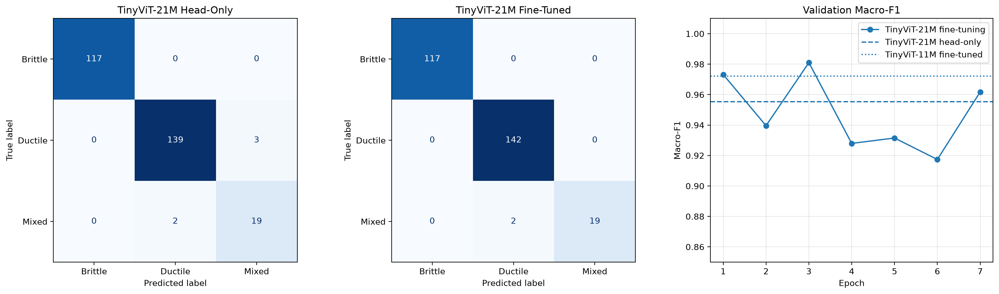
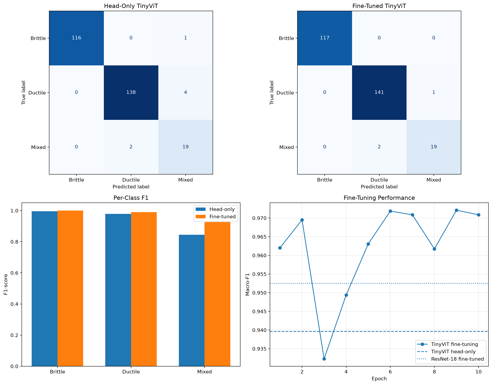

# SEM Fracture Classification Using CNNs and Vision Transformers

**Brittle, ductile and mixed fracture classification from scanning electron microscopy images**

## Abstract

This study evaluates transfer learning for three-class classification of steel fracture surfaces in scanning electron microscopy (SEM) images. ResNet-18, DeiT-Tiny, TinyViT-11M and TinyViT-21M were trained using a common dataset split and preprocessing pipeline. Both frozen-backbone classification and selective fine-tuning were evaluated. The best model, fine-tuned **TinyViT-21M**, achieved **99.29% validation accuracy**, **0.9810 macro-F1** and **0.9500 F1 for the Mixed class** on 280 validation images. It outperformed the fine-tuned ResNet-18 baseline (97.86% accuracy; 0.9525 macro-F1) on the same split and exceeded the **99.10% accuracy** reported by the original study using a **ResNet-50 binary classifier**.

## 1. Dataset and prior work

The images come from the **[SEM Image dataset](https://doi.org/10.5281/zenodo.15510590)** released by Campari and colleagues. The collection covers fracture surfaces of several steels examined after mechanical testing in hydrogen and reference atmospheres. The working dataset contains **1,961 labeled images**, grouped as follows:

| Class | Train | Validation | Reserved test | Total |
|:--|--:|--:|--:|--:|
| Brittle | 589 | 117 | 116 | 822 |
| Ductile | 711 | 142 | 143 | 996 |
| Mixed | 102 | 21 | 20 | 143 |
| **Total** | **1,402** | **280** | **279** | **1,961** |

The dataset's `Labels.csv` also contained a non-image `desktop.ini` entry, which was excluded. Only **7.3%** of valid images belong to the Mixed class.

### Original study

Campari et al. ([*Computational Materials Science*, 2026](https://doi.org/10.1016/j.commatsci.2025.114366)) investigated automated identification of **brittle and ductile** fracture morphology. They compared pretrained CNNs, including ResNet-50, EfficientNet-B4, VGG-19 and DenseNet-121. Their best reported result was **99.10% accuracy with ResNet-50** on a curated **binary** classification dataset. The work also employed Grad-CAM and sliding-window analysis to investigate fracture morphology.

The published binary dataset and evaluation protocol differ from those used here. In particular, the original binary classification excluded ambiguous transition images, whereas this study retains **Mixed** as an explicit third class. The original paper reports 2,222 curated binary images; the working three-class archive analyzed here contains 1,961 valid images.

## 2. Hypothesis and methods

The hypothesis is that **pretrained vision-transformer and hybrid CNN–Transformer models can provide competitive or improved SEM fracture classification relative to CNN baselines, particularly when Mixed fracture morphology is explicitly represented**. TinyViT is a hybrid architecture; DeiT-Tiny represents the pure transformer baseline in these experiments.

All experiments used the same `dataset_split.csv` and preprocessing:

- **Split:** 1,402 training, 280 validation and 279 reserved test images. Groups were derived from filename prefixes and kept disjoint across the three partitions. These prefixes have **not** been verified as physical specimen identifiers.
- **Input:** grayscale SEM images converted to three channels and resized to **224 × 224** pixels with bilinear interpolation; ImageNet mean/std normalization.
- **Augmentation:** random horizontal and vertical flips (each probability 0.5), training only.
- **Training:** ImageNet-1K pretrained backbones, batch size **16**, class-weighted cross-entropy and AdamW. Weights for Brittle, Ductile and Mixed were **0.7934**, **0.6573** and **4.5817**, respectively.
- **Strategy:** train a new three-class classification head with the backbone frozen, then selectively fine-tune upper layers. Head-only learning rate: **1 × 10⁻³**; fine-tuned layers: **1 × 10⁻⁵**; head during fine-tuning: **1 × 10⁻⁴**; weight decay: **1 × 10⁻⁴**.
- **Selection:** checkpoint with the highest **validation macro-F1**, which gives equal weight to the three classes. Training ran on Apple Silicon using PyTorch MPS.

For selective fine-tuning, ResNet-18 used its last residual block plus classifier; DeiT-Tiny used its final two transformer blocks plus classifier; TinyViT-11M and TinyViT-21M used the final stage plus classifier. Frozen normalization statistics were retained. The TinyViT attention modules in the trainable final stage were kept in training mode during optimization to preserve gradient flow through relative-position biases. Gradient clipping at a maximum norm of 1.0 was used for TinyViT fine-tuning.

## 3. Results

**Table 1. Best validation checkpoint for each trained configuration.** No test-set metrics are reported. FT = partial fine-tuning.

| Model | Parameters | Training | Accuracy | Macro-F1 | Mixed F1 |
|:--|--:|:--|--:|--:|--:|
| ResNet-18 | 11.18M | Head only | 97.14% | 0.9434 | 0.8696 |
| ResNet-18 | 11.18M | FT | 97.86% | 0.9525 | 0.8837 |
| DeiT-Tiny | 5.52M | Head only | 95.36% | 0.8873 | 0.7143 |
| DeiT-Tiny | 5.52M | FT | 95.36% | 0.8954 | 0.7391 |
| TinyViT-11M | 10.55M | Head only | 97.50% | 0.9396 | 0.8444 |
| TinyViT-11M | 10.55M | FT | 98.93% | 0.9721 | 0.9268 |
| TinyViT-21M | 20.62M | Head only | 98.21% | 0.9554 | 0.8837 |
| **TinyViT-21M** | **20.62M** | **FT** | **99.29%** | **0.9810** | **0.9500** |

### 3.1 TinyViT-21M

The best TinyViT-21M checkpoint was obtained at **epoch 3** of a restarted fine-tuning run (seed 43), initialized from the best head-only checkpoint (epoch 6). It correctly classified **278/280** validation images. In the head-only configuration, it classified **275/280** correctly.

**Table 2. Confusion matrix of fine-tuned TinyViT-21M.** Rows are true labels; columns are predictions.

| Actual / predicted | Brittle | Ductile | Mixed |
|:--|--:|--:|--:|
| Brittle | **117** | 0 | 0 |
| Ductile | 0 | **142** | 0 |
| Mixed | 0 | 2 | **19** |

| Class | Precision | Recall | F1 |
|:--|--:|--:|--:|
| Brittle | 1.0000 | 1.0000 | 1.0000 |
| Ductile | 0.9861 | 1.0000 | 0.9930 |
| Mixed | **1.0000** | **0.9048** | **0.9500** |

Compared with the head-only model, fine-tuning corrected three Ductile images previously predicted as Mixed: `316L_AR_21_19.png`, `316L_AR_21_20.png` and `X65_AR_12_25.png`. The two remaining errors were **Mixed → Ductile**: `316L_AR_04_15.png` and `mX65_H2_26_29.png`. The two corrected `316L_AR_21` images belong to the same filename-derived group.



*Figure 1. Confusion matrices and validation macro-F1 from the TinyViT-21M notebook. The curve corresponds to the restarted fine-tuning run.*

Fine-tuning was initialized from the best head-only checkpoint. Two training runs were conducted using random seeds 42 and 43. The best model was obtained with seed 43 at epoch 3, achieving a validation macro-F1 of **0.9810**.

### 3.2 Held-out Test Results

The fine-tuned TinyViT-21M achieved **96.06% accuracy (268/279)** and **0.8921 macro-F1** on the held-out test set, compared with 99.29% accuracy and 0.9810 macro-F1 on validation.

| Class | Precision | Recall | F1 |
|---|---:|---:|---:|
| Brittle | 0.9746 | 0.9914 | 0.9829 |
| Ductile | 0.9789 | 0.9720 | 0.9754 |
| Mixed | 0.7368 | 0.7000 | 0.7179 |

Of the 11 misclassified images, six were Mixed fractures classified as Brittle or Ductile, while five Brittle/Ductile images were classified as Mixed. Errors were concentrated in 100Cr6 and 316L samples, particularly under AR conditions.

The results indicate strong classification performance for Brittle and Ductile fractures, while **generalization to Mixed fracture morphology remains the primary limitation**.

### 3.3 Comparison with TinyViT-11M

Fine-tuned TinyViT-11M achieved **98.93% accuracy**, **0.9721 macro-F1**, and **0.9268 Mixed F1**, using **10.55M parameters**. Fine-tuned TinyViT-21M achieved one additional correct validation prediction while nearly doubling parameter count. The difference is therefore small relative to the dataset size.



*Figure 2. TinyViT-11M confusion matrices, per-class F1 and fine-tuning performance from the corresponding notebook.*

## 4. Discussion and limitations

Selective fine-tuning improved macro-F1 for both TinyViT models. The strongest gains came from reducing **false-positive Mixed predictions**, rather than increasing recall for the 21 true Mixed validation images. All remaining errors for fine-tuned TinyViT-21M were at the **Mixed–Ductile** boundary. This motivates closer examination of transitional fracture morphology and annotation consistency.

The leading TinyViT-21M model outperformed the **ResNet-18 baseline** on the same three-class validation split (**0.9810 vs. 0.9525 macro-F1**). TinyViT is a hybrid CNN–Transformer; the pure transformer DeiT-Tiny performed worse than ResNet-18 in these experiments.

Interpretation is limited by the **21 Mixed validation images**, filename-derived rather than verified specimen grouping, repeated model/checkpoint selection on a single validation partition, and two TinyViT-21M fine-tuning attempts. Differences of one or two images can change the ranking. **The 279-image test partition has not been evaluated.** A controlled three-class ResNet-50 experiment, independent specimen-level evaluation and repeated seeds are needed to assess generalization.

## 5. Repository structure

The notebooks are designed to run from the repository root (`SEM Image Database` in the local project) with the following existing structure:

```text
Brittle/                       # SEM image class folders
Ductile/
Mixed/
Labels.csv
Licence.txt
dataset_split.csv
train_resnet18.ipynb
train_resnet18_finetune.ipynb
deit_tiny.ipynb
deit_tiny_finetune.ipynb
tinyvit_11m.ipynb
tinyvit_11m_finetune.ipynb
tinyvit_21m.ipynb
tinyvit_21m_finetune.ipynb
results/
    resnet18_best.pth
    resnet18_validation_analysis.png
    resnet18_finetune/
    deit_tiny/
    deit_tiny_finetune/
    tinyvit_11m/
    tinyvit_11m_finetune/
    tinyvit_21m/
    tinyvit_21m_finetune/
README.md
```

## References

1. Campari, A., Konert, F., Razavi, N., Sobol, O., and Alvaro, A. **Hydrogen-assisted cracking: A deep learning approach for fractographic analysis.** *Computational Materials Science* **262** (2026), 114366. [doi:10.1016/j.commatsci.2025.114366](https://doi.org/10.1016/j.commatsci.2025.114366).
2. Campari, A. **SEM Image dataset.** Zenodo (2025). [doi:10.5281/zenodo.15510590](https://doi.org/10.5281/zenodo.15510590).
